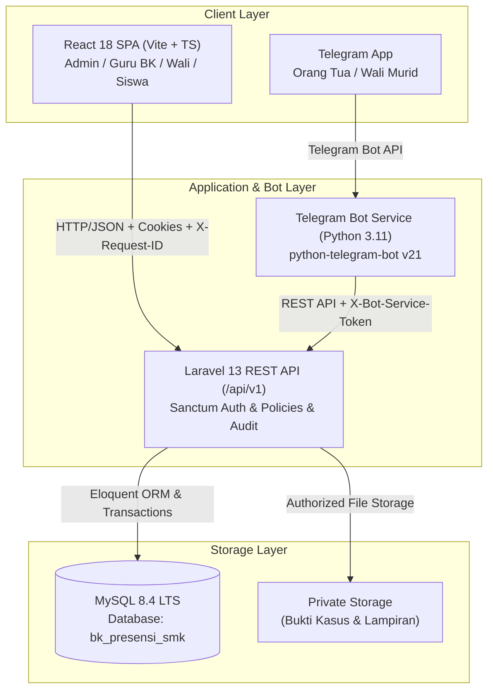
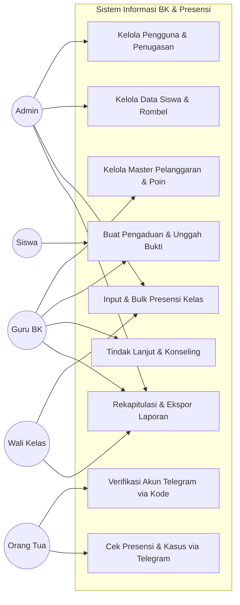
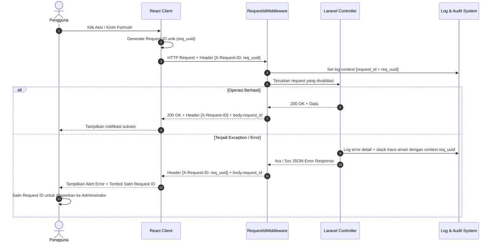

# Arsitektur Sistem Informasi BK & Presensi SMK IPTEK SANGGABUANA

Dokumen ini disusun untuk keperluan Kuliah Kerja Praktik (KKP) dan Seminar Proposal (Sempro).

---

## 1. Latar Belakang & Tujuan
SMK IPTEK SANGGABUANA membutuhkan sistem informasi terpadu untuk pencatatan presensi kehadiran siswa harian dan penanganan kasus Bimbingan Konseling (BK) yang terhubung langsung dengan Orang Tua/Wali murid melalui Bot Telegram secara aman dan menjaga kerahasiaan data siswa.

Tujuan utama sistem:
1. Mengotomatiskan rekapitulasi kehadiran fisik dengan rumus standar akademik.
2. Mencatat siklus penanganan kasus BK secara transparan (Pending ➔ Diproses ➔ Selesai).
3. Memberikan akses notifikasi dan pengecekan kehadiran kepada orang tua tanpa memberikan akses bebas ke seluruh database sekolah.
4. Menerapkan pelacakan error end-to-end melalui `X-Request-ID`.

---

## 2. Diagram Arsitektur Sistem

---

## 3. Use Case Diagram

---

## 4. Sequence Diagram Pelacakan Error End-to-End (Request ID)

---

## 5. Kebutuhan Fungsional & Nonfungsional

### Kebutuhan Fungsional
1. **Autentikasi & Otorisasi**: Role Admin, Guru BK, Wali Kelas, dan Siswa dengan Policy backend.
2. **Presensi Massal**: Input presensi per kelas dengan status Hadir, Sakit, Izin, Alpa menggunakan transaksi database.
3. **Pengaduan & Konseling**: Pencatatan kasus dengan `complaint_code`, upload berkas bukti, histori status, dan tindak lanjut rahasia.
4. **Verifikasi Wali Telegram**: Verifikasi 2 faktor menggunakan NIS dan kode pairing sekali pakai dari sekolah.
5. **Rumus Kehadiran**: Persentase Kehadiran = Hadir / Hari Sekolah Difinalisasi x 100%.

### Kebutuhan Nonfungsional
1. **Keamanan Data**: Bot Telegram dilarang mengakses MySQL secara langsung; seluruh akses harus melewati API Laravel dengan token terisolasi.
2. **Kerahasiaan Privasi**: Flag `parent_visible` membatasi catatan konseling rahasia agar tidak bocor ke publik atau bot.
3. **Audit Trail**: Seluruh operasi perubahan presensi, status pengaduan, dan pengguna dicatat di tabel `audit_logs`.
4. **Kinerja & Skalabilitas**: Frontend menggunakan caching TanStack Query dan debounced searching.
