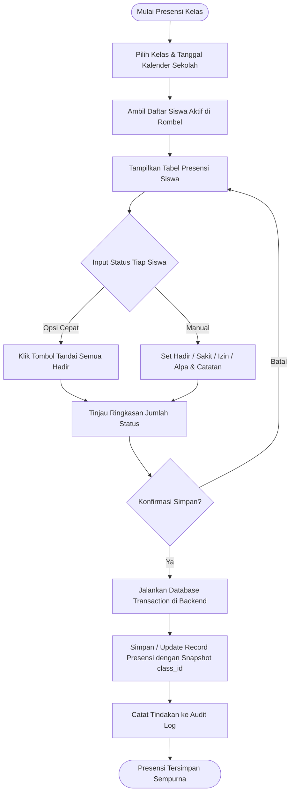
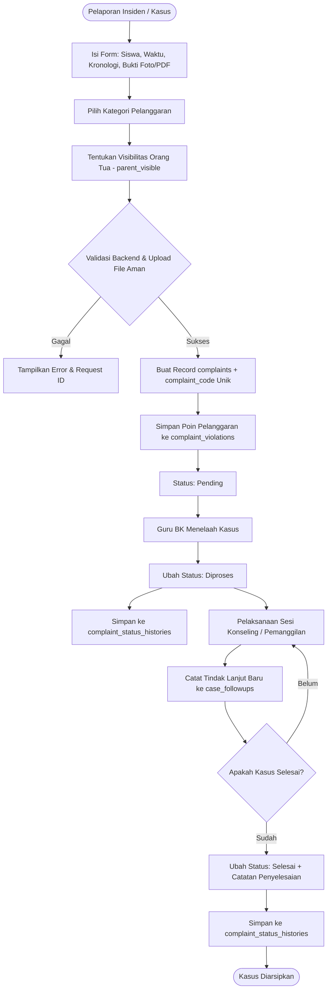
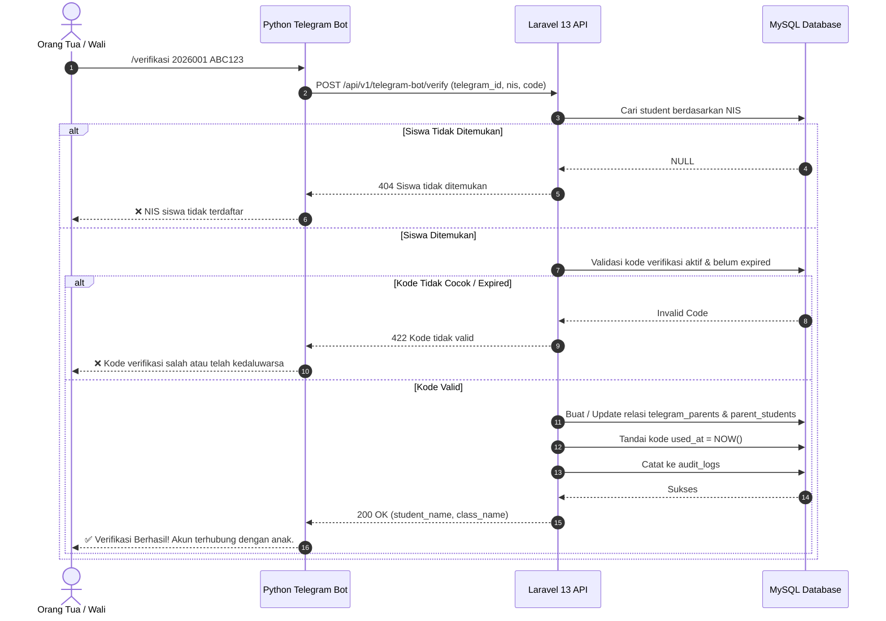

# Aturan Bisnis (Business Rules) & Activity Diagrams
## SMK IPTEK SANGGABUANA

Dokumen ini menjelaskan logika bisnis dan alur kerja Sistem Informasi BK & Presensi Siswa.

---

## 1. Aturan Bisnis Presensi

### 1.1 Status Kehadiran
1. **Hadir**: Siswa hadir di sekolah pada jam pembelajaran.
2. **Sakit**: Siswa berhalangan karena kondisi kesehatan (disertai surat/keterangan).
3. **Izin**: Siswa berhalangan dengan pemberitahuan resmi dari orang tua.
4. **Alpa**: Siswa tidak hadir tanpa keterangan yang sah.

### 1.2 Rumus Perhitungan Kehadiran Fisik
$$\text{Persentase Kehadiran} = \frac{\text{Jumlah Hari Hadir}}{\text{Total Hari Sekolah dengan Presensi Difinalisasi}} \times 100\%$$

*Ketentuan:*
- Hari libur nasional atau non-sekolah pada kalender sekolah tidak dihitung sebagai ketidakhadiran.
- Data presensi yang belum diinput tidak otomatis dianggap sebagai Alpa sebelum batas waktu (cutoff) atau sebelum difinalisasi oleh petugas.

### 1.3 Activity Diagram Alur Presensi

---

## 2. Aturan Bisnis Pengaduan BK & Konseling

### 2.1 Alur Status Kasus
$$\text{Pending (Laporan Masuk)} \longrightarrow \text{Diproses (Dalam Bimbingan)} \longrightarrow \text{Selesai (Kasus Tuntas)}$$

- **Pending**: Kasus baru masuk dari laporan mandiri siswa atau wali kelas, menunggu telaah Guru BK.
- **Diproses**: Guru BK memverifikasi insiden, memanggil siswa, menjadwalkan konseling, atau memanggil orang tua.
- **Selesai**: Siswa telah mendapatkan pendampingan, membuat komitmen perbaikan, atau menyelesaikan sanksi edukatif.

### 2.2 Activity Diagram Alur Pengaduan BK

---

## 3. Aturan Bisnis Integrasi Bot Telegram & Verifikasi

### 3.1 Pencegahan Akses Ilegal (Zero Trust on Bot)
- Bot Telegram **TIDAK** boleh mengakses data siswa hanya berbekal NIS.
- Sekolah menerbitkan Kode Verifikasi acak sekali pakai (`parent_verification_codes`).
- Backend memvalidasi `hash(kode)`, tanggal kedaluwarsa, dan batas percobaan sebelum mengaitkan `parent_students`.

### 3.2 Sequence Diagram Verifikasi Orang Tua

