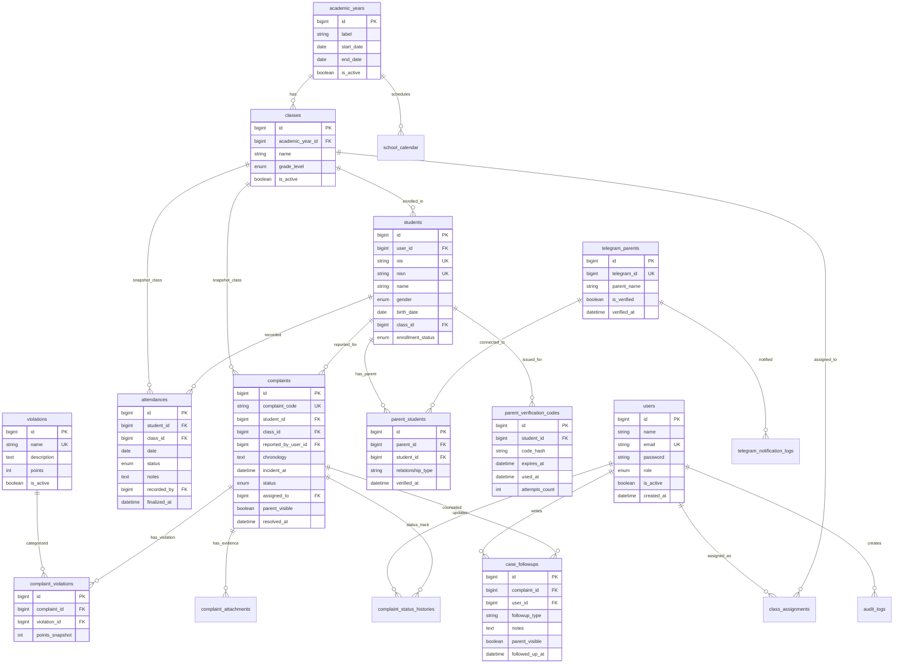

# Database Entity Relationship Diagram (ERD) & Skema Data
## SMK IPTEK SANGGABUANA (Database: `bk_presensi_smk`)

Dokumen ini mendeskripsikan struktur relasional MySQL 8.4 LTS untuk Sistem Informasi BK & Presensi Siswa.

---

## 1. Diagram ERD Lengkap (Mermaid)

---

## 2. Integritas Relasi & Constraint Penting

1. **Aturan Unique Presensi Siswa**:
   - `UNIQUE(student_id, date)` pada tabel `attendances` menjamin satu siswa tidak dapat memiliki 2 record presensi pada tanggal yang sama.
2. **Snapshot Class ID**:
   - Tabel `attendances` dan `complaints` menyimpan snapshot `class_id` saat presensi atau insiden dicatat, sehingga mutasi/kenaikan kelas siswa di masa depan tidak merusak laporan historis.
3. **Point Snapshot Pelanggaran**:
   - Tabel penghubung `complaint_violations` menyimpan kolom `points_snapshot` dari tabel `violations`. Ketika bobot master pelanggaran diubah oleh Guru BK, nilai poin kasus terdahulu tidak terpengaruh.
4. **Verifikasi Orang Tua Dua Faktor**:
   - Kolom `code_hash` menyimpan nilai SHA-256 / bcrypt dari kode verifikasi. Kolom `expires_at`, `used_at`, dan `attempts_count` mencegah serangan brute-force dan replay attacks.
5. **Privasi Kasus (Parent Visible)**:
   - Kolom boolean `parent_visible` pada `complaints` dan `case_followups` mengontrol secara presisi apakah laporan tersebut dapat ditarik oleh bot Telegram orang tua.
